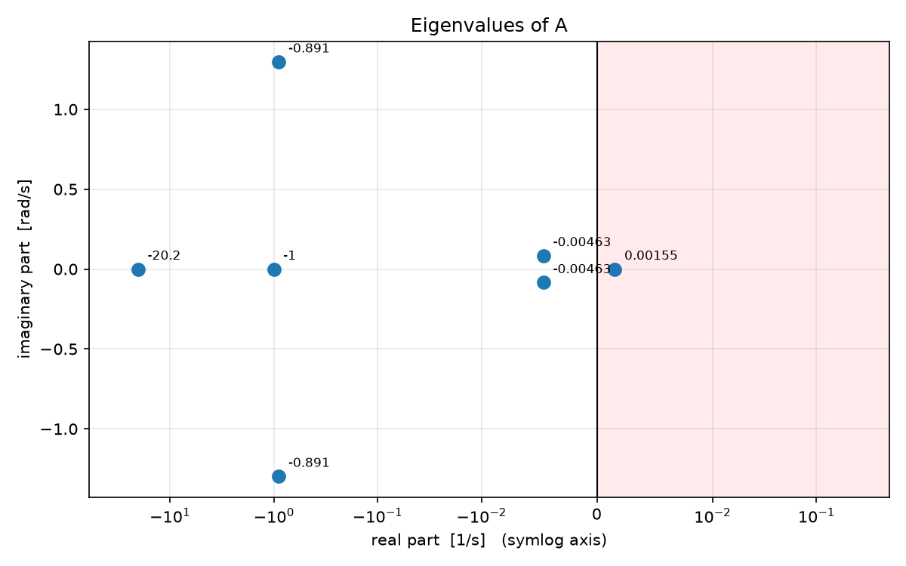
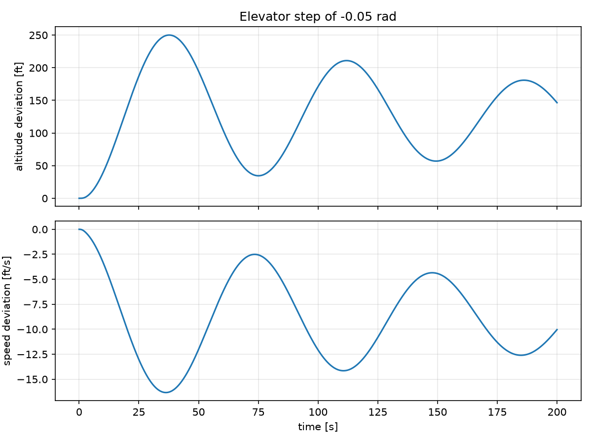

# M1: Units and the longitudinal plant model

**Status:** complete. **Code:** `src/navigation_control_flight_simulation/units.py`, `src/navigation_control_flight_simulation/plant.py`. **Tests:** `tests/` (13 tests). **Results script:** `experiments/m1_exercises.py`.

## 1. Objective

Build the foundation the rest of the project stands on: one place for unit conversions, one trusted aircraft model, and measurements of the dynamics the controllers will have to deal with. No controller is built in this milestone.

## 2. Mathematical background

### 2.1 The model

The aircraft's longitudinal (pitch-plane) motion is a linear state-space model:

```math
\dot{\tilde x} = A \tilde x + B \tilde u, \qquad \tilde y = C \tilde x
```

| Symbol | Content |
|---|---|
| $x \in \mathbb{R}^7$ | altitude $h$ (ft), pitch $\theta$ (rad), speed $V$ (ft/s), angle of attack $\alpha$ (rad), pitch rate $q$ (rad/s), thrust actuator, elevator actuator |
| $u \in \mathbb{R}^2$ | thrust command, elevator command (rad) |
| $y \in \mathbb{R}^5$ | $[h, \theta, -7V, \alpha, q]$; speed carries a scale factor of $-7$ |

Two rows of $A$ have an immediate physical reading. Altitude rate is kinematic,

```math
\dot h = V_0 (\theta - \alpha) = V_0 \gamma, \qquad V_0 = 500 \text{ ft/s},
```

because the flight-path angle is $\gamma = \theta - \alpha$. The two actuators are first-order lags,

```math
\dot x_{\text{thrust}} = -x_{\text{thrust}} + u_1 \quad (\tau = 1 \text{ s}), \qquad \dot x_{\text{elev}} = -20.2 x_{\text{elev}} + 20.2 u_2 \quad (\tau = 0.05 \text{ s}),
```

so the inputs reach the aircraft only through these actuator states. The remaining rows hold the course's aerodynamic coefficients, which are data and are not re-derived here.

### 2.2 Linearisation and deviation coordinates

A nonlinear model $\dot x = f(x,u)$ is approximated around an operating point $(x_0, u_0)$ by

```math
f(x,u) \approx f(x_0,u_0) + A (x - x_0) + B (u - u_0), \qquad A = \frac{\partial f}{\partial x}, \quad B = \frac{\partial f}{\partial u}.
```

At a true equilibrium $f(x_0,u_0) = 0$ and only the deviations $\tilde x = x - x_0$, $\tilde u = u - u_0$ remain. The model is therefore valid **only for deviations**, and the project always simulates $\tilde x$ and adds the trim back for display and for FlightGear.

For the course numbers the operating point is not an exact equilibrium: the residual $r = A x_{\text{trim}} + B u_{\text{trim}}$ is non-zero in three rows (section 5.3). Feeding the absolute state into the model is therefore wrong, not merely inelegant (section 5.6).

### 2.3 Modal analysis

Each eigenvalue $\lambda = \sigma + j\omega_d$ of $A$ is a natural motion proportional to $e^{\sigma t}$. Comparing with the standard second-order system $s^2 + 2\zeta\omega_n s + \omega_n^2 = 0$, whose roots are $-\zeta\omega_n \pm j\omega_n\sqrt{1-\zeta^2}$:

```math
\omega_n = |\lambda|, \qquad \zeta = -\frac{\sigma}{|\lambda|}, \qquad T = \frac{2\pi}{\omega_d}, \qquad \tau = \frac{1}{|\sigma|}.
```

$\tau$ is the time for the motion to change in size by a factor $e$ (a decay time for $\sigma<0$, a growth time for $\sigma>0$). A real eigenvalue does not oscillate, so $\zeta$ and $T$ do not apply to it.

### 2.4 Controllability and observability (Hautus test)

$(A,B)$ is controllable if and only if

```math
\mathrm{rank} \begin{bmatrix} \lambda I - A & B \end{bmatrix} = n \quad \text{for every eigenvalue } \lambda \text{ of } A.
```

If the rank drops, some left eigenvector $w$ satisfies $w^\top A = \lambda w^\top$ and $w^\top B = 0$: the quantity $w^\top x$ evolves on its own and no input can reach it. Observability is the mirror image, with the matrix

```math
\begin{bmatrix} \lambda I - A \\ C \end{bmatrix}.
```

The smallest singular value of the matrix is the distance to the nearest rank-deficient matrix, so it serves as a margin: small means almost uncontrollable (or unobservable). The value depends on the units of the states, so it is used to compare modes of the same model and not as an absolute physical measure.

### 2.5 Zero-order-hold discretisation

A computer simulates in steps of $\Delta t = 0.01$ s with the input held constant over each step. The exact solution over one step is

```math
x(\Delta t) = e^{A\Delta t} x(0) + \Big( \int_0^{\Delta t} e^{As} ds \Big) B u,
```

and both matrices come from a single matrix exponential:

```math
\begin{bmatrix} \Phi & \Gamma \\ 0 & I \end{bmatrix} = \exp\left( \begin{bmatrix} A & B \\ 0 & 0 \end{bmatrix} \Delta t \right), \qquad x_{k+1} = \Phi x_k + \Gamma u_k .
```

This works because the top-right block of the series $\sum_k M^k \Delta t^k / k!$ equals $\sum_k A^{k-1} B \Delta t^k / k! = \int_0^{\Delta t} e^{As} B ds$. It avoids the formula $A^{-1}(\Phi - I)B$, which needs $A^{-1}$; here $A$ is nearly singular ($\kappa(A) = 4.2\times10^8$, section 5.3).

### 2.6 Units

The plant is in feet and radians (the course's convention); geodesy, missions and FlightGear use metres. All conversions go through `navigation_control_flight_simulation.units`: 1 ft = 0.3048 m exactly, $g_0 = 9.80665$ m/s² $= 32.17405$ ft/s².

## 3. Implementation

| Module | Responsibility |
|---|---|
| `units.py` | `ft2m`, `m2ft`, `deg2rad`, `rad2deg`, constants `M_PER_FT`, `G0_SI`, `G0_FT` |
| `plant.py` | frozen dataclass `LongitudinalPlant` ($A$, $B$, $C$, trim); `discretize(dt)`; `eigenvalues()`; `with_thrust_scale(kappa)`; `to_absolute` / `to_deviation`; factory `course_plant()` |

The thrust scale $\kappa$ multiplies the thrust column of $B$ and returns a new plant; it exists for the thrust-authority sweep planned in M4.

## 4. Verification

13 automated tests pass (`python -m pytest -v`):

| Test | What it guarantees |
|---|---|
| exact foot definition, 10,000 ft = 3048 m, array round trip, gravity | unit conversions are exact; a wrong constant is caught (a round trip alone would not catch it, because the error cancels) |
| sizes (7, 2, 5) | no typo in the pasted matrices |
| eigenvalues and damping | the model reproduces the independently measured modes |
| Hautus margins above $10^{-6}$ | every mode is controllable and observable; the margin differences are reported below |
| trim residual is non-zero | the deviation-only fact is documented as a test |
| ZOH versus continuous | $\Phi = e^{A\Delta t}$; 100 steps equal the exact 1 s response; the eigenvalues of $\Phi$ equal $e^{\lambda \Delta t}$ |
| thrust scale | only the thrust column of $B$ changes; the original plant is untouched |
| absolute/deviation round trip | the two conversions are inverses |

## 5. Results

All numbers below are produced by `experiments/m1_exercises.py`, except the trim residual and conditioning number in section 5.3, which come from the one-liner given there.

### 5.1 Natural modes

| Mode | Eigenvalue | $\omega_n$ (rad/s) | $\zeta$ | $T$ (s) | $\tau$ (s) |
|---|---|---|---|---|---|
| elevator actuator | $-20.2$ | 20.2 | n/a | n/a | 0.05 |
| thrust actuator | $-1.0$ | 1.0 | n/a | n/a | 1.00 |
| short period | $-0.8915 \pm 1.2969j$ | 1.574 | 0.566 | 4.84 | 1.12 |
| phugoid | $-0.0046 \pm 0.0846j$ | 0.0847 | 0.055 | 74.30 | 216.2 |
| slow mode | $+0.0016$ | 0.0016 | n/a | n/a | 644.9 (growth) |



### 5.2 Controllability and observability margins

| Mode | Controllability margin | Observability margin |
|---|---|---|
| elevator actuator | 0.565 | 0.0324 |
| thrust actuator | 0.012 | 0.000111 |
| short period | 0.0225 | 1 |
| phugoid | 0.00121 | 0.999 |
| slow unstable mode | **1.76e-05** | 1 |

### 5.3 Trim residual and conditioning

The residual is

```math
A x_{\text{trim}} + B u_{\text{trim}} = [0, 0, -7.74, -0.198, -0.112, 0, 0]
```

(speed, angle-of-attack and pitch-rate rows), and $\kappa(A) = 4.16\times10^{8}$. Both come from:

```
python -c "from navigation_control_flight_simulation.plant import course_plant; import numpy as np; p = course_plant(); print(np.round(p.A @ p.x_trim + p.B @ p.u_trim, 4)); print(np.linalg.cond(p.A))"
```

### 5.4 Elevator step response

A constant elevator deviation of $-0.05$ rad (thrust unchanged) for 200 s:

| Quantity | Value |
|---|---|
| altitude peaks at | 37.7 s, 111.9 s, 186.2 s |
| time between peaks | 74.2 s |
| altitude deviation at 30 s | +225.9 ft |
| speed deviation at 30 s | −15.3 ft/s |



### 5.5 Energy exchange

With thrust unchanged, specific energy is nearly conserved, so

```math
\Delta h + \frac{V_0}{g} \Delta V \approx 0.
```

Measured over the 200 s elevator step:

| Quantity | Value |
|---|---|
| largest $\lvert \Delta h \rvert$ | 250.1 ft |
| largest $\lvert \Delta h + (V_0/g) \Delta V \rvert$ | 20.6 ft (8% of the altitude swing) |

### 5.6 Why the model must be fed deviations

Integrating the model from $x_{\text{trim}}$ with $u_{\text{trim}}$ *as absolute values*, for 10 s: altitude 12,606.7 ft, speed 304.3 ft/s, pitch 53.4° (a trimmed aircraft would stay at 10,000 ft, 500 ft/s, 3.66°). In deviation form the same experiment stays exactly at trim.

## 6. Interpretation

- **Three time scales.** Actuators are fast (0.05 s and 1 s), the short period is a well-damped oscillation (ζ = 0.57, T = 4.8 s), and the phugoid is a lightly damped slow oscillation (ζ = 0.055, T = 74 s). A 3.5 s prediction horizon covers about 0.7 short-period cycles but only about 5% of a phugoid cycle, and the 54 s mission is shorter than one phugoid period. The controller is therefore expected to see phugoid motion as a slow drift, not as an oscillation it can plan around (to be checked in M2).
- **Two independent computations agree.** The simulated spacing of altitude peaks (74.2 s) matches the phugoid period predicted from the eigenvalues (74.3 s), and the first altitude peak (37.7 s) is close to half that period (37.2 s). This is the strongest evidence in M1 that the discretised simulation and the modal analysis describe the same model.
- **Altitude and speed are tied together.** The elevator step raises the nose, altitude climbs 250 ft and speed falls by up to about 16 ft/s. The combination $\Delta h + (V_0/g)\Delta V$ stays within 21 ft while altitude swings by 250 ft, so most of the exchange is energy-conserving. This is the physical basis for hypothesis H-a: a speed reference that ignores this relation asks the controller for something the aircraft cannot do with an inert thrust. Whether it improves gate accuracy is not shown by M1 and is tested in M2 (first look) and M3 and M4.
- **The slow unstable mode is hard to reach.** Its controllability margin ($1.8\times10^{-5}$) is three orders of magnitude below the short-period margin. It grows with a time constant of 645 s, which is irrelevant over a 54 s mission but matters for long runs and for any integrator-based baseline.
- **The thrust actuator is nearly invisible.** Its observability margin is $1.1\times10^{-4}$ and it affects speed with a coefficient of only $0.0016$ ft/s² per unit thrust. Thrust is therefore treated as nearly inert, with its authority swept through $\kappa$ rather than guessed.
- **The trim is a label, not an equilibrium.** The residual of $-7.74$ ft/s² in the speed row is a constant deceleration (77 ft/s in 10 s on its own). Through the coupling with the pitch response it produces the 196 ft/s loss and the 53° pitch-up of section 5.6 when the absolute state is used.
