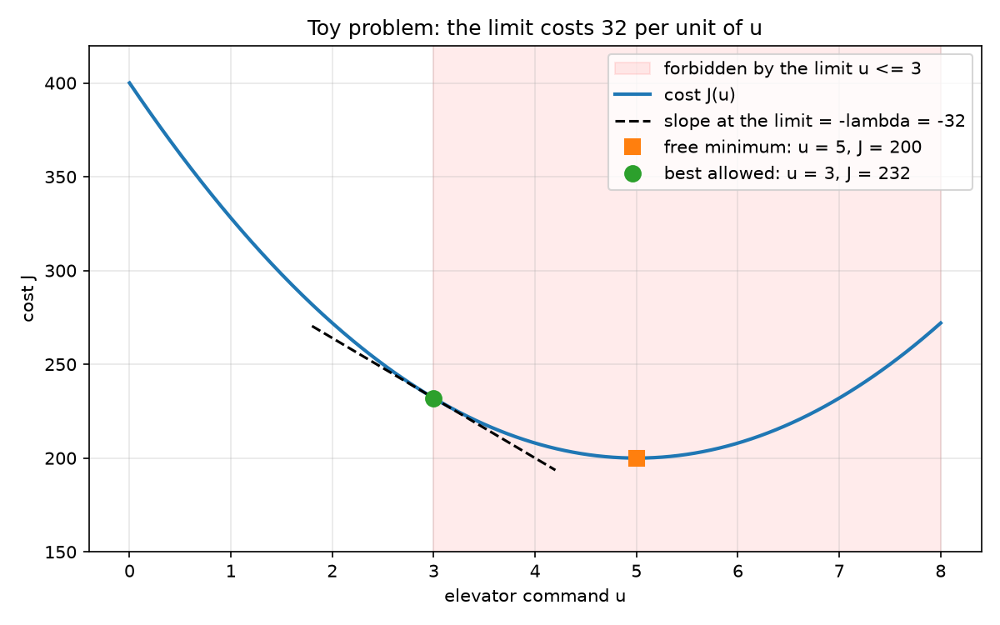
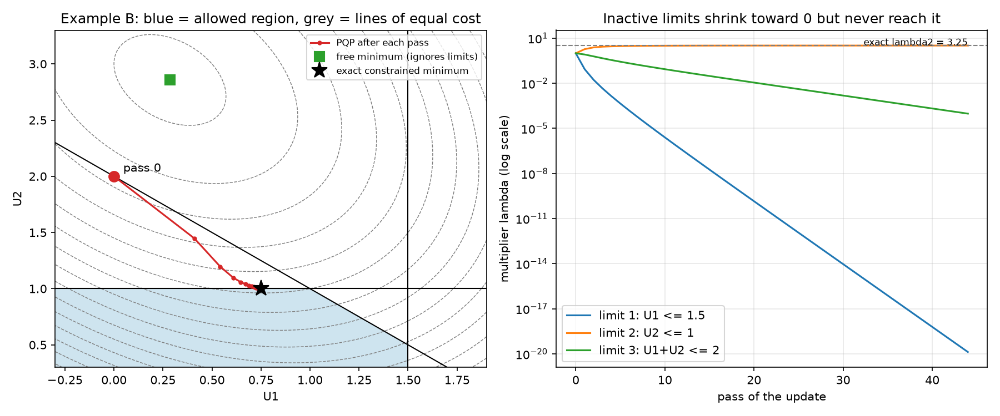
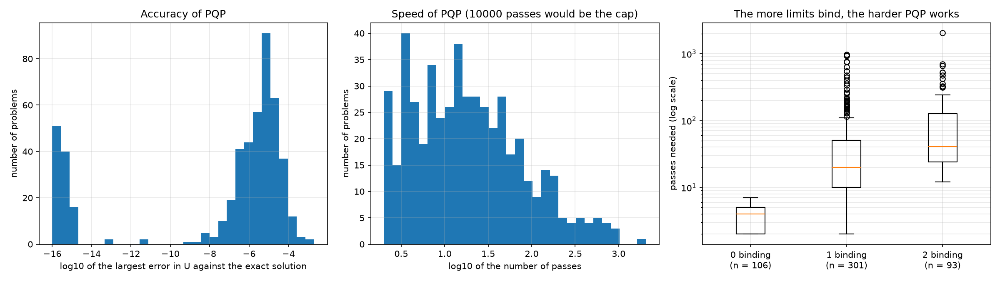
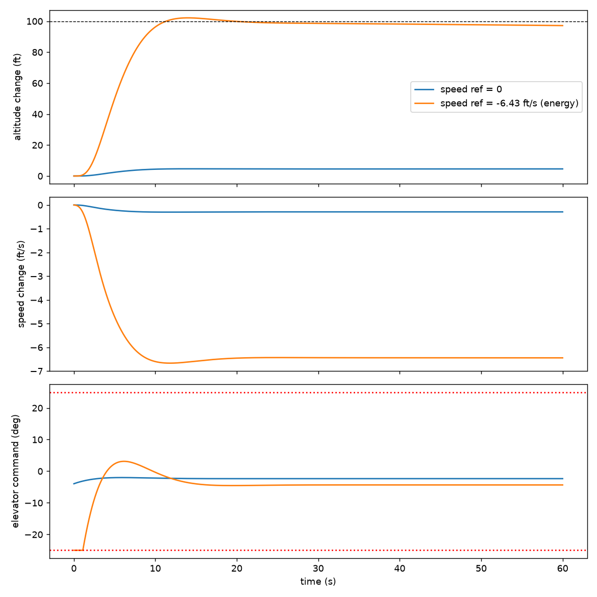

# M2: Quadratic-programming solver and the baseline controller C0

**Status:** complete. **Code:** `src/navigation_control_flight_simulation/qp.py`, `src/navigation_control_flight_simulation/mpc_baseline.py`. **Tests:** `tests/` (27 tests in total, 14 of them new in M2). **Results scripts:** `experiments/m2_qp_study.py`, `experiments/m2_fg_check.py`, `experiments/m2_closed_loop.py`.

## 1. Objective

Build the optimisation engine and the baseline controller (C0) that the rest of the project is compared against: a solver for quadratic programs with input limits, and an explicit model-predictive controller that turns an altitude and speed target into thrust and elevator commands while respecting the actuator limits. Then run C0 in closed loop and look at what it does.

## 2. Mathematical background

### 2.1 The optimisation problem (QP)

At each decision the controller chooses an input vector $U$ (thrust and elevator) that minimises a cost, which measures how far the predicted outputs are from the reference and how large the input is, subject to actuator limits. With a linear model and a quadratic cost this is a quadratic program:

```math
\min_{U} J(U) = U^\top H U + 2 f^\top U \qquad \text{subject to} \qquad M U \le g
```

with $H$ symmetric positive definite, so $J$ is a bowl with a single minimum. This is the course's convention (the factor 2 sits on the linear term). Without limits the minimum is where the gradient vanishes, $2HU + 2f = 0$, so $U = -H^{-1} f$. The limits matter when this point violates $MU \le g$.

### 2.2 Optimality conditions and the meaning of the multipliers

Attach a multiplier $\lambda_i \ge 0$ to each limit:

```math
\mathcal{L}(U,\lambda) = U^\top H U + 2 f^\top U + \lambda^\top (M U - g).
```

At the constrained minimum the Karush-Kuhn-Tucker (KKT) conditions hold:

```math
2HU + 2f + M^\top \lambda = 0, \qquad MU \le g, \qquad \lambda \ge 0, \qquad \lambda_i (MU - g)_i = 0.
```

The last condition says a limit has a non-zero multiplier only if it is active (the solution sits on it). $\lambda_i$ is the price of limit $i$: the increase in cost per unit that the limit is tightened. The first condition gives the solution as a function of the multipliers:

```math
U = -H^{-1} \left( f + \tfrac{1}{2} M^\top \lambda \right).
```

A one-variable check: $J(u) = 8u^2 - 80u + 400$ with limit $u \le 3$. The free minimum is $u = 5$; the first KKT condition at $u = 3$ reads $16 \cdot 3 - 80 + \lambda = 0$, so $\lambda = 32$.

### 2.3 The dual problem

Substituting $U(\lambda)$ into $\mathcal{L}$ and maximising over $\lambda \ge 0$ is equivalent to a problem in the multipliers only:

```math
\min_{\lambda \ge 0} \tfrac{1}{2} \lambda^\top W \lambda + Z^\top \lambda, \qquad W = \tfrac{1}{2} M H^{-1} M^\top, \qquad Z = M H^{-1} f + g.
```

It has one variable per limit and only a non-negativity constraint, which is much easier to handle. The primal solution is recovered with the formula for $U(\lambda)$ above.

### 2.4 The PQP multiplicative update

Split $W$ and $Z$ into non-negative parts, $W^+ = \max(W,0)$, $W^- = \max(-W,0)$ elementwise (and likewise $Z^+$, $Z^-$), so that $W = W^+ - W^-$. The course's method (PQP) updates one multiplier at a time:

```math
\lambda_i \leftarrow \lambda_i \frac{Z_i^- + (W^- \lambda)_i}{Z_i^+ + (W^+ \lambda)_i}.
```

Starting from $\lambda = 1$, the iterates stay positive because every step multiplies by a non-negative ratio. A multiplier with $\lambda_i > 0$ stops changing exactly when the ratio is 1, which is the condition $(W\lambda + Z)_i = 0$, the gradient of the dual being zero: the KKT condition. The loop stops when the squared change of $\lambda$ over a full pass drops below a tolerance ($10^{-9}$). Two properties follow from the form of the update: a multiplier at exactly zero can never leave zero, and an inactive limit's multiplier decays towards zero without ever reaching it.

### 2.5 Exact oracle

For testing, `solve_exact` tries every subset of limits as the active set, solves the corresponding KKT linear system, and keeps the feasible candidate with the lowest cost. It costs $2^m$ systems for $m$ limits, so it is a test oracle and not a controller component.

### 2.6 The baseline controller C0 (explicit MPC)

Hold the input $u$ constant over a horizon $N_p = 3.5$ s and predict the outputs at the end of the horizon:

```math
y(N_p) = F x + G u, \qquad F = C \Phi(N_p), \qquad G = C \Gamma(N_p),
```

where $\Phi(N_p)$ and $\Gamma(N_p)$ come from the same block matrix exponential as in M1 with $\Delta t = N_p$ (equal to the course's $G = C A^{-1} (\Phi - I) B$, but without inverting the nearly singular $A$). With the error against the free response $E = r - F x$, the cost

```math
J(u) = (r - y)^\top Q (r - y) + u^\top R u
```

expands to the QP form of section 2.1:

```math
J(u) = u^\top H u + 2 f^\top u + \text{const}, \qquad H = G^\top Q G + R, \qquad f = -G^\top Q E.
```

Without limits the minimiser is

```math
u = K E, \qquad K = H^{-1} G^\top Q,
```

and the gain $K$ is computed once, offline; online the controller does one matrix-vector product. This is why the method is called explicit. If $KE$ violates a limit, the QP of sections 2.1 to 2.4 is solved with the same $H$ and $f$. At every time step the state $x$ is measured and the procedure repeats (receding horizon), which closes the loop.

Three properties of this particular controller matter later. It uses a single constant move over the whole horizon. It penalises only the output at the end of the horizon, not the path. And only the altitude and the $-7V$ rows of $E$ are filled; the other rows are zero, which means the controller only avoids pushing $\theta$, $\alpha$ and $q$ away from their free response.

**Weights.** $Q = \mathrm{diag}(1, 1, 49, 1, 1)$ and $R = \mathrm{diag}(20, 50)$ are the course's values. They are tuning choices, not derived quantities, and are kept unchanged so that C0 is comparable with the course. Because the speed output is $-7V$, the weight 49 on that row means $49 \cdot 7^2 = 2401$ per $(\text{ft/s})^2$ of speed error, against 1 per ft$^2$ of altitude error.

**Limits in deviation coordinates.** The QP variable is a deviation, $\tilde u = u - u_{\text{trim}}$, so the real limits (thrust 0 to 1, elevator $\pm 25°$) are shifted by the trim:

```math
\tilde u_{\min} = u_{\min} - u_{\text{trim}}, \qquad \tilde u_{\max} = u_{\max} - u_{\text{trim}}.
```

With $u_{\text{trim}} = [0.06, -0.0393]$ this gives thrust in $[-0.06, 0.94]$ and elevator in $[-0.3970, +0.4756]$ rad ($-22.75°$ to $+27.25°$ as a deviation). The course code applies the limits directly to the deviation, which would allow an absolute elevator range of $-27.25°$ to $+22.75°$ and forbid any thrust below trim. This project uses the shifted, physically correct limits.

### 2.7 Energy-consistent speed reference

With thrust nearly inert, a climb is paid for with speed: $\Delta h + (V_0/g) \Delta V = 0$, so

```math
\Delta V = -\frac{g}{V_0} \Delta h, \qquad r_{-7V} = -7 \Delta V = \frac{7g}{V_0} \Delta h \approx 0.450 \Delta h.
```

For $\Delta h = +100$ ft the energy-consistent speed target is $\Delta V = -6.43$ ft/s. The course uses the ratio 0.5 instead of 0.450.

## 3. Implementation

| Module | Responsibility |
|---|---|
| `qp.py` | `solve_pqp(H_inv, f, M, g)` (the multiplicative update, with optional per-pass callback), `solve_exact(H, f, M, g)` (active-set oracle), `cost(H, f, U)`, result record `QPResult` (solution, multipliers, passes, converged flag, largest violation) |
| `mpc_baseline.py` | class `ExplicitMPC`: builds $F$, $G$, $H$, $H^{-1}$, $K$ and the shifted limits once; `control(x, h_ref, V_ref)` returns the command, using $KE$ when it is feasible and the QP otherwise |

Differences from the course solver: it accepts a single limit (the course version crashes on one constraint), reports whether it converged and the largest limit violation, and can report the multipliers after each pass.

## 4. Verification

27 automated tests pass (`python -m pytest -v`): 4 for units, 9 for the plant, 11 for the QP solver and 3 for C0.

| Test group | What it guarantees |
|---|---|
| QP, two hand-solvable problems (example A: two limits, one binds; example B: three limits, one binds) | known solutions and multipliers are reproduced |
| QP, loose limits, single limit, elevator toy ($u = 3$, $\lambda = 32$ for limit 3; $u = 5$, $\lambda = 0$ for limit 8) | the unconstrained case, the single-limit crash and the price interpretation |
| QP, 200 random problems against the exact oracle | PQP agrees with the exact oracle |
| QP, iteration cap, inconsistent limits, shape mismatch | failures are reported, not hidden |
| C0, $G$ against the course formula | the matrix-exponential route and $C A^{-1} (\Phi - I) B$ agree to $10^{-8}$ |
| C0, small request | the command equals $K E$ exactly (no QP) |
| C0, large request (needs about $-38°$) | the command respects every limit and equals the exact oracle's answer within $10^{-4}$ |

## 5. Results

### 5.1 QP toy problem

For $J(u) = 8u^2 - 80u + 400$ with limit $u \le 3$: the free minimum is $u = 5$ ($J = 200$); the best allowed point is $u = 3$ ($J = 232$) and the price of the limit is $\lambda = 32$, the slope of the cost at the limit.



### 5.2 Two variables, three limits (PQP step by step)

$H = [[2, 0.5], [0.5, 1]]$, $f = [-2, -3]$, limits $U_1 \le 1.5$, $U_2 \le 1$, $U_1 + U_2 \le 2$.

| | $U$ | $\lambda$ |
|---|---|---|
| PQP (44 passes, converged) | [0.749974, 1.000009] | [0, 3.2499, 9.6e-05] |
| exact | [0.75, 1.0] | [0, 3.25, 0] |

Largest limit violation at exit: $9.0\times10^{-6}$. The inactive limits' multipliers shrink but never reach exactly zero (the third is $9.6\times10^{-5}$ instead of 0).



### 5.3 PQP against the exact solution on 500 random problems (2 variables, 4 limits)

| Quantity | Median | 95th percentile | Maximum |
|---|---|---|---|
| largest error in $U$ against the exact solution | $2.2\times10^{-6}$ | $7.4\times10^{-5}$ | $2.0\times10^{-3}$ |
| passes needed | 16 | 264 | 2057 |

Largest limit violation over all problems: $8.8\times10^{-5}$. Cost gap (PQP minus exact): between $-3.2\times10^{-4}$ and $+3.1\times10^{-4}$ (slightly negative when PQP stops marginally outside a limit).

| Limits that really bind | Problems | Median error | Median passes | Maximum passes |
|---|---|---|---|---|
| 0 | 106 | $2.2\times10^{-16}$ | 4 | 7 |
| 1 | 301 | $3.4\times10^{-6}$ | 20 | 967 |
| 2 | 93 | $9.1\times10^{-6}$ | 41 | 2057 |



### 5.4 One decision of C0 (prediction at the horizon end)

$G$ for the plant (columns thrust, elevator): the elevator column is $[-73.07, -0.163, -70.08, -0.054, -0.035]$ for the outputs $[h, \theta, -7V, \alpha, q]$, the thrust column is almost zero, $[0.0006, 0, -0.0277, 0, 0]$. The resulting $H$ has entries $20.04$, $95.13$ and $246{,}026$ (thrust, coupling, elevator): the elevator entry is dominated by the speed row, $49 \cdot 70^2 \approx 240{,}000$, so $R_{\text{elev}} = 50$ hardly matters.

Unconstrained solution $u = K E$ for a climb of $+100$ ft with different speed targets, and the outputs predicted at the end of the horizon (from `experiments/m2_fg_check.py`):

| Speed target | Elevator command | Predicted $\Delta h$ | Predicted $-7V$ row |
|---|---|---|---|
| none (0) | $-1.7°$ | 2.2 ft | 2.1 |
| energy-consistent (0.450 $\Delta h$) | $-37.7°$ | 48 ft | 46 |
| course ratio (0.5 $\Delta h$) | $-41.7°$ | 53 ft | 51 |

### 5.5 C0 in closed loop: a +100 ft climb

Plant step 0.01 s, 60 s, constant target (`experiments/m2_closed_loop.py`):

| | speed target 0 | speed target $-6.43$ ft/s (energy) |
|---|---|---|
| altitude at 60 s (target 100 ft) | 4.6 ft | 97.2 ft |
| largest altitude error after 10 s | 95.6 ft | 3.7 ft |
| speed change at 60 s | $-0.29$ ft/s | $-6.44$ ft/s |
| steps with a limit active | 0.0% | 1.8% |
| controller time per step (mean, max) | 0.01 ms, 0.4 ms | 0.02 ms, 4.3 ms |

With the energy-consistent target the altitude reaches 100 ft after about 10 to 12 s, overshoots to 102.2 ft, and then drifts slowly down (99.9 ft at 20 s, 97.2 ft at 60 s). The elevator sits at the $-25°$ limit for about the first 1.2 s and then comes off it.



## 6. Interpretation

- **The solver is accurate but not fast in the worst case.** On random problems PQP is typically within $10^{-5}$ of the exact solution after a few tens of passes, but the number of passes grows with the number of binding limits (maximum 2057, against a median of 16). The solution is slightly infeasible by construction (violations up to $10^{-4}$ in the random study), because the iteration stops before the multipliers converge exactly. For C0, with two inputs and four limits, this is harmless; with the larger problems of the incremental controller (C1, M4) the pass count and the tiny violations must be watched.
- **Why a speed target of zero fails.** Over the 3.5 s horizon the elevator moves the altitude row and the $-7V$ row almost together (ratio about 0.96), and thrust is nearly inert. Asking for a climb while holding speed is therefore contradictory, and because a speed error is weighted 2401 times more than an altitude error, the controller gives up the climb: 4.6 ft out of 100 in closed loop. With the energy-consistent speed target the request becomes consistent with the physics and the climb succeeds. This is a first, favourable look at hypothesis H-a, but it is a single deterministic run, without noise, on one step size; the evidence rule (at least 80% of Monte Carlo seeds, median effect above the spread) is applied in M4, so H-a is not yet counted as supported.
- **Over a short horizon the energy-consistent target is only approximately reachable.** The prediction for the energy-consistent target (section 5.4) reaches about half of the altitude in one horizon, because the elevator alone cannot hit both rows; the closed loop recovers the rest over successive steps.
- **Saturation is brief here.** The elevator limit is active for about 1.8% of the steps in this single 100 ft step, much less than the 63% measured earlier on the course's staircase scenario with repeated 108 ft steps. The two numbers are different experiments; the staircase figures will be re-measured on the real mission in M3.
- **Slow drift.** The altitude settles near the target and then decays by about 3 ft in 40 s. C0 has no integral action and the model has the slow unstable mode of M1, so a small steady error is expected. It is far below the $\pm 50$ ft gate tolerance.
- **The controller is cheap enough for 100 Hz in this setting.** The worst control call took 4.3 ms against a 10 ms period, measured in Python on a cloud machine; this is indicative and depends on the computer.
- **Not measured: QP against plain clipping.** The benefit of solving the QP over simply clipping $KE$ to the limits was not measured in closed loop in this milestone. With only two inputs and a very strong elevator effect, the two may differ little for C0; the question becomes important for the larger problems of C1.
