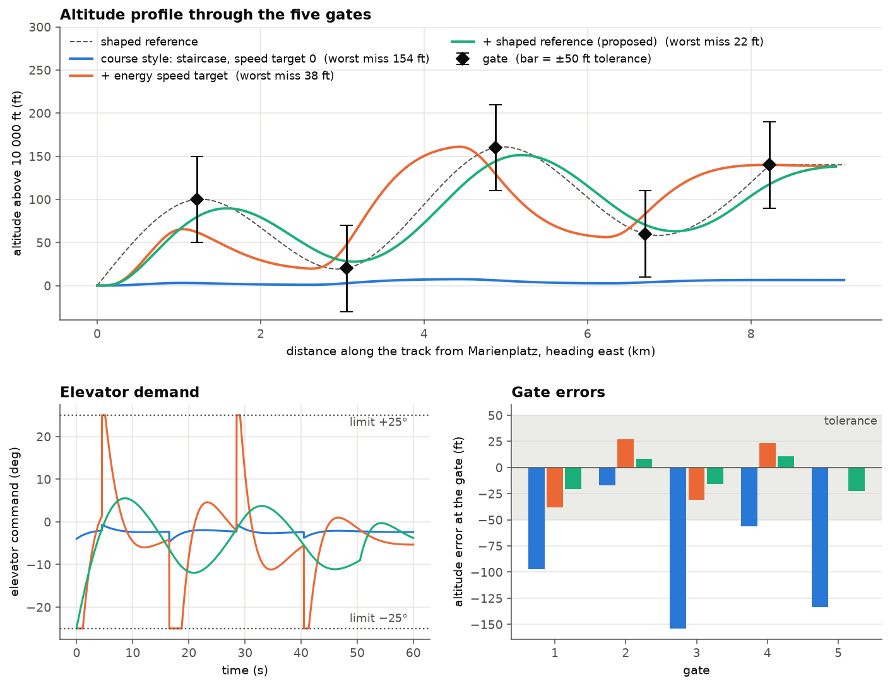

# M3: Munich mission, geodesy, references and FlightGear replay

**Status:** complete. **Code:** `src/navigation_control_flight_simulation/geodesy.py`, `src/navigation_control_flight_simulation/mission.py`. **Tests:** `tests/` (40 tests in total, 13 of them new in M3). **Results scripts:** `experiments/m3_geodesy_check.py`, `experiments/m3_gates.py`, `experiments/m3_export_flight.py`, `experiments/m3_replay.py`.

## 1. Objective

Turn the controller of M2 into a mission: put the aircraft over Munich, define five altitude gates on a real route, fly them in closed loop with C0, measure how well the gates are passed, test whether the speed target and the shape of the altitude reference matter, and replay the flight in FlightGear. M3 produces the first measured look at hypotheses H-a and H-b; it does not yet produce evidence, because every result here is a single noise-free run (evidence comes from the Monte Carlo study of M4).

## 2. Mathematical background

### 2.1 From latitude and longitude to metres: WGS84, ECEF and NED

The plant works in feet along a straight line, while FlightGear wants latitude, longitude and altitude. The bridge between them is the WGS84 ellipsoid with semi-major axis $a = 6378137$ m and flattening $f = 1/298.257223563$, so that the first eccentricity squared is $e^2 = f(2-f)$.

A geodetic point (latitude $\varphi$, longitude $\lambda$, height $h$ above the ellipsoid) is converted to Earth-centred Earth-fixed (ECEF) Cartesian coordinates with the prime-vertical radius $N(\varphi) = a / \sqrt{1 - e^2 \sin^2\varphi}$:

```math
x = (N + h)\cos\varphi\cos\lambda, \qquad y = (N + h)\cos\varphi\sin\lambda, \qquad z = \big(N(1-e^2) + h\big)\sin\varphi .
```

The inverse (ECEF to geodetic) has no closed form that is both short and exact. The code uses a fixed-point iteration: start from $\varphi_0 = \mathrm{atan2}\big(z,\ r(1-e^2)\big)$ with $r = \sqrt{x^2+y^2}$, then repeat $h = r/\cos\varphi - N$ and $\varphi = \mathrm{atan2}\big(z,\ r(1 - e^2 N/(N+h))\big)$. Ten passes are far more than needed (the round trip over 100 random points is tested to one micrometre).

The local frame NED (North, East, Down) is a plane tangent to the ellipsoid at an origin $(\varphi_0, \lambda_0, h_0)$. A point $P$ in ECEF has the local coordinates

```math
\begin{bmatrix} N \\ E \\ D \end{bmatrix} = R (P - P_0), \qquad
R = \begin{bmatrix}
-\sin\varphi_0\cos\lambda_0 & -\sin\varphi_0\sin\lambda_0 & \cos\varphi_0 \\
-\sin\lambda_0 & \cos\lambda_0 & 0 \\
-\cos\varphi_0\cos\lambda_0 & -\cos\varphi_0\sin\lambda_0 & -\sin\varphi_0
\end{bmatrix}.
```

$R$ is a rotation (its transpose is its inverse), so the way back is $P = P_0 + R^\top [N, E, D]^\top$. Down is positive, so altitude gained is negative $D$.

### 2.2 The tangent plane leaves the Earth

A straight line in the tangent plane is not at a constant height above the ellipsoid: the surface curves away below it. At a distance $s$ from the origin the plane is higher above the surface by about $s^2/(2R_E)$, with $R_E \approx 6.37 \times 10^6$ m. For the mission length, $s = 8230$ m, this is 5.3 m, or 17 ft, a third of the gate tolerance. This is why the project fixes the following rule: **the horizontal position of a point on the route comes from the NED plane (converted to latitude and longitude), but its height is taken directly from the altitude of the plant**, never from the tangent-plane coordinate $D$.

The gates and the aircraft are also given the same altitude reference (the ellipsoid height of the origin plus the plant's altitude deviation). The geoid, the difference between the ellipsoid and mean sea level, is about 45 to 50 m at Munich and is ignored, because only the altitude of the aircraft relative to the gates matters.

### 2.3 The mission

The route is a straight track due east (heading 90°) from Marienplatz, Munich ($48.1374°$ N, $11.5755°$ E, $h_0 = 3048$ m $= 10000$ ft). The aircraft starts at the trim of M1 (500 ft/s). The five gates are crossed nominally at $t = 8, 20, 32, 44, 54$ s, i.e. at $s = V_0 t$ = 4000, 10 000, 16 000, 22 000 and 27 000 ft (1219 to 8230 m), with altitudes above the start of $+100, +20, +160, +60, +140$ ft. Successive gates differ by 80 to 140 ft, so the aircraft has to climb, descend, climb, descend and climb.

| Gate | Time (s) | Distance (m) | Latitude | Longitude | Altitude (ft) | Altitude (m) |
|---|---|---|---|---|---|---|
| 1 | 8 | 1219 | 48.137399 | 11.591873 | 10 100 | 3078.5 |
| 2 | 20 | 3048 | 48.137393 | 11.616433 | 10 020 | 3054.1 |
| 3 | 32 | 4877 | 48.137381 | 11.640993 | 10 160 | 3096.8 |
| 4 | 44 | 6706 | 48.137365 | 11.665553 | 10 060 | 3066.3 |
| 5 | 54 | 8230 | 48.137347 | 11.686020 | 10 140 | 3090.7 |

The latitude drifts slightly south of $48.1374°$ because a due-east line in the tangent plane is not a parallel of latitude.

### 2.4 Gate error

A gate is a place, not a moment. The aircraft slows down while it climbs (the energy exchange of M1), so it reaches the gate distance later than $t_k$. The gate error is therefore measured at the instant the flown distance $s(t) = \sum (V_0 + \Delta V)\Delta t$ reaches the gate distance:

```math
e_k = h\big(t^\ast_k\big) - h_k^{\mathrm{gate}}, \qquad s(t^\ast_k) = V_0 t_k .
```

The primary metrics are the worst miss $\max_k |e_k|$ and the root-mean-square miss $\sqrt{\tfrac{1}{5}\sum_k e_k^2}$, in feet. The frozen tolerance of $\pm 50$ ft is the pass/fail criterion; in a single run it only counts how many of the five gates pass.

### 2.5 The altitude references

The controller is given an altitude reference $h_{\mathrm{ref}}(t)$ and looks at the value a preview time $N_p = 3.5$ s ahead, because C0 aims at the end of its prediction horizon (M2).

**Raw reference (staircase).** Right after a gate is passed, the next gate's altitude is commanded as a step. This is what the course scenario does, and it is untuned: no attempt is made to start the climb early.

**Shaped reference.** Instead of steps, the reference is the smoothest path through the five gates. On a 0.1 s grid with $N$ points $z_0, \dots, z_{N-1}$, the roughness is the sum of squared second differences, and the gate altitudes (and the starting value $z_0 = 0$) are equality constraints:

```math
\min_{z} \sum_{i=1}^{N-2} \left( z_{i-1} - 2 z_i + z_{i+1} \right)^2 \qquad \text{subject to} \qquad C z = v ,
```

where $C$ picks the gate samples and $v$ holds their altitudes. Writing the roughness as $\|Dz\|^2$ with $D$ the second-difference matrix, the optimality (KKT) conditions are one linear system:

```math
\begin{bmatrix} 2 D^\top D & C^\top \\ C & 0 \end{bmatrix}
\begin{bmatrix} z \\ \mu \end{bmatrix} =
\begin{bmatrix} 0 \\ v \end{bmatrix}.
```

A tiny term $10^{-9} I$ is added to the top-left block so that the matrix is safely invertible (the second difference ignores a constant and a straight line). The solution is the discrete analogue of a natural cubic spline through the gates. After the last gate the altitude is held. The path is interpolated to the 0.01 s plant step.

This equality-constrained problem is a QP without inequality limits, so one linear solve gives the exact answer. The shaped reference uses all five gates in advance, which a real aircraft would know from a flight plan.

### 2.6 Speed target

The speed reference is either $0$ (course style) or the energy-consistent value from M1 and M2, $\Delta V_{\mathrm{ref}} = -(g/V_0)\Delta h_{\mathrm{ref}}$, which pairs every altitude change with the speed change that conserves energy.

## 3. Implementation

- `geodesy.py`: `llh_to_ecef`, `ecef_to_llh`, `ned_rotation`, `llh_to_ned`, `ned_to_llh` (WGS84, degrees and metres).
- `mission.py`: the mission constants, `track_llh` (route point to latitude, longitude, height), `raw_reference`, `shaped_reference`, `fly` (closes the loop between an `ExplicitMPC` and the plant at 100 Hz with a given reference and speed-target mode), `gate_errors`.
- `m3_export_flight.py` writes the flights to `results/flight_course.csv` and `results/flight_proposed.csv` (time, latitude, longitude, altitude, pitch, angle of attack, elevator) and the gate errors to `results/gates_*.csv`. These files are regenerated by the script and are not committed.
- `m3_replay.py` streams one of those flights to FlightGear through the course's native FDM interface (section 5.4).

## 4. Verification

The 13 new tests cover: known ECEF points; the origin maps to zero NED; $R$ is a proper rotation; the length of one degree of latitude and longitude at Munich; up is negative down; the round trip geodetic, NED, geodetic; the tangent plane leaves the Earth by the expected 5.3 m; the gates lie east of the start at the right height and in metres; the shaped reference passes exactly through every gate and has no jumps; and two closed-loop checks (the course-style flight misses the gates; the energy-consistent shaped flight passes all five within $\pm 50$ ft).

`experiments/m3_geodesy_check.py` prints the numbers quoted in section 5.1.

## 5. Results

### 5.1 Geometry of the route

At Munich one degree of latitude is 111.25 km and one degree of longitude is 74.46 km. Flying 8230 m due east in the tangent plane changes the longitude by $+0.1105°$, and the plane ends 5.30 m (17.4 ft) above the ellipsoid, which confirms the rule of section 2.2.

### 5.2 C0 flies the five gates

Noise-free, 60 s, plant step 0.01 s, $N_p = 3.5$ s (`experiments/m3_gates.py`):

| Configuration | Worst miss (ft) | RMS miss (ft) | Gates within 50 ft | Elevator range (deg) | Steps with a limit active |
|---|---|---|---|---|---|
| Course style: staircase, speed target 0 | 153.9 | 104.3 | 1 of 5 | $-4.7$ to $-0.6$ | 0.0% |
| Staircase, energy speed target | 38.1 | 27.1 | 5 of 5 | $-25.0$ to $+25.0$ | 10.0% |
| **Shaped reference, energy speed target (proposed)** | **22.3** | **16.4** | 5 of 5 | $-24.8$ to $+5.5$ | 0.0% |
| Shaped reference, speed target 0 | 153.5 | 104.5 | 1 of 5 | $-3.3$ to $-1.9$ | 0.0% |

Altitude error at each gate (ft; negative means below the gate):

| Configuration | Gate 1 | Gate 2 | Gate 3 | Gate 4 | Gate 5 |
|---|---|---|---|---|---|
| Course style | $-97.1$ | $-17.3$ | $-153.9$ | $-56.3$ | $-133.5$ |
| Staircase, energy speed target | $-38.1$ | $+27.1$ | $-31.0$ | $+23.1$ | $-0.1$ |
| Shaped reference, energy speed target | $-20.4$ | $+8.3$ | $-15.8$ | $+10.5$ | $-22.3$ |

Total elevator movement (the sum of the absolute changes of the elevator command) is 261° for the staircase with the energy target and 93° for the proposed configuration. The proposed flight reaches the gates at 8.04, 20.14, 32.28, 44.46 and 54.58 s, a little later than nominal because the aircraft slows down while it climbs.



### 5.3 What was measured, in short

Adding the energy speed target reduces the worst miss from 154 ft to 38 ft; adding the shaped reference on top reduces it further to 22 ft and removes the saturation. The shaped reference without the energy speed target changes nothing (153.5 ft against 153.9 ft).

### 5.4 FlightGear replay

`m3_replay.py` loads a saved flight and, about 30 times a second, writes the current sample into FlightGear's native FDM structure (latitude, longitude, altitude, pitch, angle of attack, elevator as a fraction of 25°, heading east, zero roll). FlightGear runs with `--fdm=null`, so it performs no flight dynamics of its own: it only displays the pose that Python sends. The flight loops after 60 s and the script prints a message at each gate time. Running it with the proposed flight printed all five gate messages, and the flight displayed in FlightGear was inspected and judged consistent with the saved data. The replay starts at 10 000 ft and 500 ft/s because the plant is a model around that cruise condition; take-off is not modelled. The gates themselves are not drawn in FlightGear (see section 6).

## 6. Interpretation

- **The course-style baseline is effectively level flight.** With a speed target of zero, C0 hardly climbs at all: its altitude at 60 s is 6.4 ft against a 140 ft final gate. The "miss" of 154 ft at gate 3 is simply the gate's own altitude (160 ft) minus the few feet the aircraft gained. This repeats the finding of M2 on a larger scale: the altitude request and the zero-speed request contradict each other, and the heavy speed weight wins. This is also why the elevator never saturates in this configuration (range $-4.7°$ to $-0.6°$), and why the 63% saturation measured on the course scenario in the earlier preliminary look is not reproduced here.
- **The energy speed target is what makes the mission flyable (first look at H-a).** The worst miss falls from 154 ft to 38 ft and all five gates are inside $\pm 50$ ft. This is a single noise-free run, so H-a is not counted as supported until M4.
- **Shaping does not help on its own; it helps once the speed target is consistent (first look at H-b).** With the speed target at zero, the shaped reference gives the same 153.5 ft, because the failure is the contradictory target and not the shape of the reference. With the energy target, the shaped reference lowers the worst miss from 38 ft to 22 ft, the RMS miss from 27 ft to 16 ft, and the elevator demand from a pattern of large swings (10% of the steps on a limit, total movement 261°) to a smooth one (no step on a limit, total movement 93°).
- **The remaining error is lag, not noise.** The proposed errors alternate in sign ($-20, +8, -16, +10, -22$ ft): after each climb the aircraft is a little below the gate and after each descent a little above it. The aircraft follows the reference with a delay. A reference that leads, for example one that starts the manoeuvre earlier, could reduce this; this is a tuning of the references and is left to M4.
- **The comparison with the staircase is unfair in one direction.** The staircase is untuned: it steps only right after each gate. A staircase that steps earlier would probably do better than 38 ft. The shaped reference also uses the positions of all five gates in advance. Both points go to M4 as a tuned-staircase baseline before H-b is claimed.
- **The drift of M2 is still there.** C0 has no integral action, and at 60 s the proposed flight holds 138.2 ft against the final gate's 140 ft; this is small against the tolerance.
- **The tolerance of $\pm 50$ ft cannot separate the two good runs.** Both the staircase with the energy target and the proposed flight pass 5 of 5, so a pass count says nothing about which is better. This is why the comparison uses the worst and RMS miss in feet; the $\pm 50$ ft criterion is kept unchanged and becomes a pass rate over many seeds in M4.
- **What M3 does not show.** There is no disturbance, no sensor noise, no model error, one mission and one controller. The results describe what C0 does on this deterministic flight, not how robust the improvements are.

## 7. Limitations carried forward

- The gates are not visible in FlightGear. Only the aircraft is displayed; gate crossings are announced in the console.
- The replay starts at cruise: ground phases are outside the model.
- All results are single noise-free runs (M4: disturbances and Monte Carlo seeds).
- Tuned-staircase baseline and a leading reference (M4).
- The gate and aircraft altitudes share one reference; the geoid offset is ignored.
