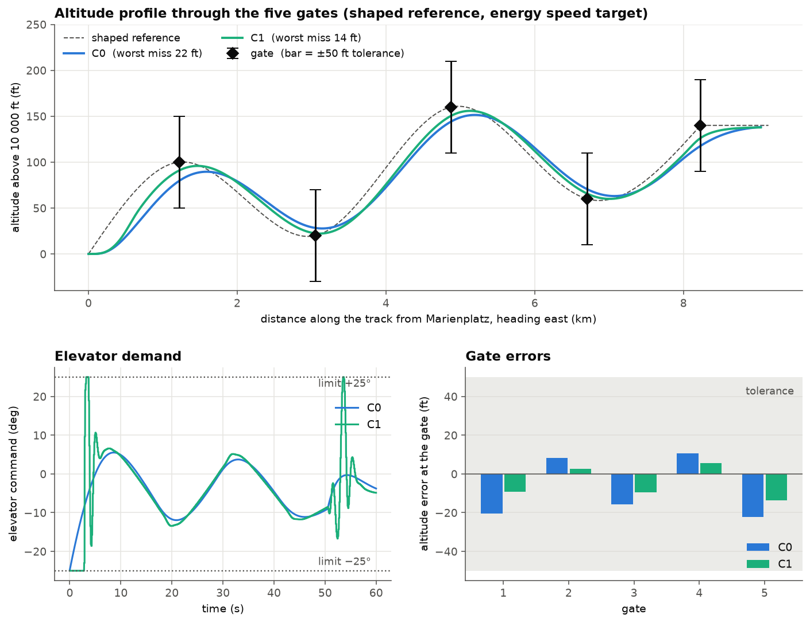
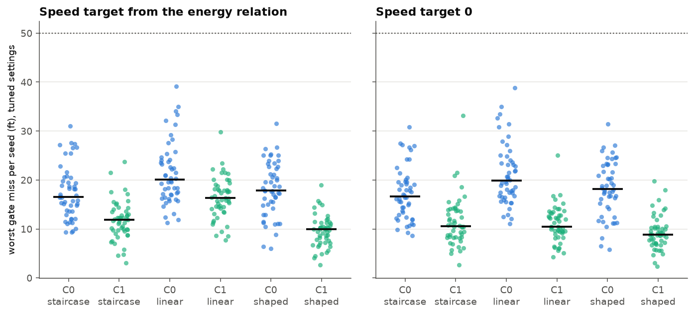

# M4: Incremental multi-step MPC (C1), disturbances and ablations

**Status:** complete. **Code:** `src/navigation_control_flight_simulation/mpc_incremental.py` (C1) and additions to `mission.py` (random worlds, references, flights of C1, elevator rate limit). **Tests:** `tests/` (49 tests in total, 9 of them new in M4). **Results scripts:** `experiments/m4_solver_check.py`, `experiments/m4_c1_vs_c0.py`, `experiments/m4_monte_carlo.py`, `experiments/m4_tune.py`, `experiments/m4_final.py`.

## 1. Objective

Test hypothesis H-c (an incremental multi-step MPC, C1, beats the one-shot baseline C0 when the actuator limits are active) and decide H-a and H-b with evidence: random disturbances, many seeds, fair baselines and ablations. The evidence rule is fixed in `REPORT.md`: an improvement counts only if it holds in at least 80% of the seeds and the median effect exceeds the seed-to-seed spread.

## 2. Mathematical background

### 2.1 What C0 does and what C1 does differently

C0 (M2) chooses **one constant** thrust and elevator for the whole prediction horizon (3.5 s) and looks only at the **predicted altitude and speed at the end** of the horizon. It is cheap: one matrix-vector product, or one small QP when a limit is hit. But when the elevator saturates it cannot plan a sequence such as full back stick first and easing off later, and it cannot see the path in between.

C1 chooses a **whole sequence** of commands over the horizon and looks at the predicted error at **every step**. It has three ingredients that C0 lacks:

- **a sequence of moves**, so it can use the allowed range at the right moments (for example, a strong early elevator command to start a climb and an opposite command later to stop it before it overshoots, which the phugoid of M1 makes necessary);
- **a path cost**, so it penalises the error along the way and not only at the end;
- **a preview of the reference** over the whole horizon, so it can start a manoeuvre before the reference asks for it.

C1 is applied at 10 Hz (a new problem is solved every 0.1 s, the command is held between solves). C0 is the special case of C1 with one block, one step and the whole horizon as the sampling time; the test `test_c0_is_the_special_case` checks that C1 built this way returns the same command as C0.

Two honest consequences. First, C1 receives more information than C0 (the whole reference over the horizon), so part of any gain may come from the preview and not from better handling of the limits; the ablations of M4.4 separate the two. Second, C1 has more weights to tune, so tuning is done on one set of random seeds and the comparison on different seeds.

### 2.2 The incremental form

The model is discretised at $T_s = 0.1$ s, $x_{j+1} = \Phi x_j + \Gamma u_j$, with deviations from trim as before, and the horizon is $N = 35$ steps (3.5 s). The unknowns are the **changes** of the command, not the commands themselves:

```math
u_j = u_{\mathrm{prev}} + \Delta u_0 + \Delta u_1 + \dots + \Delta u_j ,
```

where $u_{\mathrm{prev}}$ is the command applied at the previous sample. Stacking the predicted outputs of all steps gives

```math
Y = F x + G(\mathbf{1} \otimes u_{\mathrm{prev}}) + G_b \Delta U ,
```

with $F$ the stacked free response, $G$ the block lower-triangular matrix of the input-to-output responses, and $G_b$ the same matrix after the move blocking of section 2.3. With the error $E = r - F x - G(\mathbf{1} \otimes u_{\mathrm{prev}})$ (only the altitude and the $-7V$ rows are nonzero, as in C0) and the weights $\bar Q = I_N \otimes Q$, $\bar R = I_{n_b} \otimes R$, the cost is

```math
J = (E - G_b \Delta U)^\top \bar Q (E - G_b \Delta U) + \Delta U^\top \bar R \Delta U ,
```

which is the same quadratic form as in M2, $J = \Delta U^\top H \Delta U + 2 f^\top \Delta U$ with $H = G_b^\top \bar Q G_b + \bar R$ and $f = -G_b^\top \bar Q E$.

Penalising $\Delta u$ keeps the commands smooth. The actuator limits apply to the commands, which are running sums of the changes, so they become **cumulative-sum conditions**: $u_{\min} \le u_{\mathrm{prev}} + L\Delta U \le u_{\max}$ with $L$ a lower-triangular matrix of ones. A limit on each $\Delta u$ alone would be wrong, because many small changes can add up beyond the limit.

Only the first command is applied; at the next sample the problem is solved again from the new state (receding horizon).

### 2.3 Move blocking

With 2 inputs and 35 steps there would be $2 \times 35 = 70$ unknowns and $2 \times 70 = 140$ limits. Move blocking lets the input change only at six chosen steps, here steps 0, 1, 2, 4, 8 and 16 (times 0, 0.1, 0.2, 0.4, 0.8 and 1.6 s), and holds it constant in between. This gives $2 \times 6 = 12$ unknowns and 24 limits, a problem only a little larger than C0's, and it puts the freedom of the command where it matters most, at the start of the horizon.

### 2.4 The limits are boxes: bounded least squares

Write the problem in the absolute block commands $z_b = u_{\mathrm{prev}} + \sum_{b' \le b} \Delta u_{b'}$. Then $\Delta U = D (z - z_0)$ with $D$ the first-difference matrix and $z_0 = \mathbf{1} \otimes u_{\mathrm{prev}}$, and the limits are simple bounds $z_{\min} \le z \le z_{\max}$. With the Cholesky factor $H = L_c L_c^\top$ the cost completes to a square,

```math
J = \left\| L_c^\top D z - b \right\|^2 + \text{const}, \qquad b = L_c^\top D z_0 - L_c^{-1} f ,
```

so each decision is a **bounded least-squares problem**, which scipy's BVLS solves exactly in a finite number of steps. The first command is the first block of $z$.

## 3. Implementation

- `mpc_incremental.py`: class `IncrementalMPC(plant, Ts=0.1, N=35, blocks=(0, 1, 2, 4, 8, 16), Q, R)`; `control(x, u_prev, h_ref, V_ref)` takes the state, the previous command and the reference over the next $N$ steps and returns the new command (deviation). The limits are the real actuator limits shifted by the trim, as in C0.
- `mission.py` additions: `fly_c1` (closed loop of C1 at its own sample rate, with optional preview of the whole reference or only its end value), `make_world` (random gust and elevator error, section 5.3), `linear_reference` (straight lines between the gates), `shifted` (a reference moved in time), and an optional `rate_deg_s` that limits how fast the real elevator can move in both `fly` and `fly_c1`. With no world and no rate limit the flights behave exactly as in M3.
- `experiments/m4_tune.py` tunes every configuration on the tuning seeds and writes `results/tuned.json`; `experiments/m4_final.py` reads it and runs the comparison and the ablations.

## 4. Verification

Tests of C1 (`tests/test_mpc_incremental.py`): C1 with one step, one block and $T_s = N_p$ returns the command of C0 for a small request and for one that hits the limits; with nothing to do the command is zero; for a +100 ft climb request the command respects the limits and equals an independent solution of the same problem (L-BFGS-B on the bounds) to within 0.001. Tests of the mission additions (`tests/test_mission.py`): C1 passes all gates and beats C0 on a noise-free flight; a world is reproducible for a given seed and has the stated gust size and elevator range; a flight with no world is the nominal flight and a flight with a world is not; the straight-line reference passes through the gates; a shifted reference is the same curve later; the elevator rate limit is respected by both controllers.

## 5. Results

### 5.1 Solver choice (M4.1)

The first version of C1 used the course's PQP (M2). On the problem above (12 unknowns, 24 limits, condition number of $H$ about $3 \times 10^5$) it did **not converge in 10 000 passes** and took 506 ms; the exact bounded least-squares solver takes 1.2 ms. The first commands agree to $3 \times 10^{-5}$ (elevator at its limit, $-25.0°$), so PQP's answer was usable but 400 times slower and not converged. At 10 Hz for 60 s with many seeds, the PQP version would need minutes per flight. This is the "PQP worst case against the time budget" issue recorded after M2, now measured: PQP is fine for C0's four limits and unsuitable for C1. C1 therefore uses the exact bounded least-squares solver (`experiments/m4_solver_check.py` reproduces the numbers).

### 5.2 C1 against C0 on the mission, noise-free (M4.2)

Same mission, same references, same speed targets, plant step 0.01 s; C0 decides every 0.01 s, C1 every 0.1 s (`experiments/m4_c1_vs_c0.py`). C1 uses C0's weights unchanged and sees the reference over its whole horizon.

| Controller | Reference | Worst miss (ft) | RMS miss (ft) | Gates within 50 ft | Elevator at a limit | Elevator movement (deg) |
|---|---|---|---|---|---|---|
| C0 | staircase | 38.1 | 27.1 | 5 of 5 | 9.0% | 261 |
| C1 | staircase | 26.0 | 18.1 | 5 of 5 | 51.0% | 999 |
| C0 | shaped | 22.3 | 16.4 | 5 of 5 | 0.0% | 93 |
| C1 | shaped | **13.8** | **9.0** | 5 of 5 | 5.8% | 312 |
| C1, speed target 0 | shaped | 147.1 | 99.9 | 1 of 5 | 0.7% | 94 |
| C1, one move, end value only (closest to C0) | staircase | 39.4 | 29.2 | 5 of 5 | 15.7% | 295 |
| C1, one move, end value only (closest to C0) | shaped | 12.9 | 8.7 | 5 of 5 | 2.2% | 105 |



Observations that matter for the interpretation:

- C1 is more accurate than C0 on both references (worst miss 26 against 38 ft on the staircase, 14 against 22 ft on the shaped reference).
- C1 reaches this by using the actuator range: the elevator sits at its limit for the first 3 s of the first climb, then swings to +25° within one sample, and again near gate 5. The elevator movement is 3 to 4 times larger than C0's. No elevator rate limit is modelled, so this swing is optimistic.
- Without the energy speed target, C1 fails as C0 does (147 ft): the contradictory speed target is not fixed by a better controller.
- C1 uses thrust over its whole range (0 to 1) while C0 stays within 0.03 to 0.11; freezing thrust at trim changes C1's worst miss by less than 1 ft, so thrust is not the source of the gain (thrust is nearly inert in this model, M1).
- A C1 with one move, a reference reduced to its end value and the same 10 Hz incremental cost was as accurate as the full C1 on the shaped reference in this untuned run (12.9 against 13.8 ft). This suggested that the gain over C0 came from the incremental cost and not from the multi-step plan. **This did not survive tuning:** with tuned settings the same ablation shows that the multi-step plan and the preview are what matters (section 5.6, ablation 1).

### 5.3 Disturbances and Monte Carlo (M4.3)

**Random world.** Each seed fixes one world with two random elements, and the controllers know neither:

- a **vertical gust**, a first-order Gauss-Markov process with rms 5 ft/s (moderate turbulence) and correlation time 3 s, entering as an angle-of-attack disturbance $\alpha_g = w / V_0$: the plant becomes $\dot x = A x + B u + A_{:,\alpha} \alpha_g$, so the aerodynamics see $\alpha + \alpha_g$;
- an **elevator effectiveness error**: the elevator column of $B$ of the plant that flies is scaled by a uniform random factor in $[0.8, 1.2]$, while the controller keeps the nominal model.

The controllers still measure the full state without noise (a Kalman filter is the optional M5). The gust level and the 20% error are physically motivated choices fixed before any result was looked at.

**Protocol.** Seeds 100 to 119 are the tuning seeds, used to develop the harness and to tune weights (M4.4). Seeds 0 to 49 are the test seeds, run once with all configurations and weights final. Comparisons are paired (the same world for both configurations). A comparison is supported only if the better configuration wins in at least 80% of the seeds and the median improvement is larger than the standard deviation of the per-seed improvements (the seed-to-seed spread); this rule was written into the script before the test seeds were run (the results are in section 5.5).

**Disclosure.** The test seeds were run once, with the final script, before the code was committed to git, so the git history cannot show that the rule preceded the run. The rule and the list of comparisons are in the docstring of `experiments/m4_final.py`, which was not changed after the test run, and the tuning used only the tuning seeds.

### 5.4 Tuning (M4.4)

**Fair tuning.** The first Monte Carlo look (section 5.3 protocol, tuning seeds) used the course's settings for every configuration. Exploring the settings showed that two knobs dominate the result: the **weight on the speed error** $q_v$ (the course uses 49 on $-7V$, an effective weight of 2401 against 1 on altitude) and a **time shift of the reference** (the controllers look 3.5 s ahead, so a reference that already leads is aimed at too early). Each configuration was therefore tuned separately on the tuning seeds 100 to 109, by searching the delay (-1 to 4 s), then $q_v$ (0.01 to 49), then the delay again, with the median worst miss as the criterion (`experiments/m4_tune.py`). The staircase is also given a delay as its tuning knob (the previous open issue: "stepping earlier" was the wrong direction; stepping later is better, because the controller already previews).

Median worst gate miss over the tuning seeds (ft), course settings then tuned:

| Controller | Reference | Speed target | Course settings | Tuned | $q_v$ | Delay (s) |
|---|---|---|---|---|---|---|
| C0 | staircase | energy | 41.4 | 15.2 | 0.1 | 2 |
| C0 | staircase | 0 | 157.0 | 14.2 | 0.01 | 2 |
| C0 | linear | energy | 32.9 | 17.9 | 0.1 | 0 |
| C0 | linear | 0 | 156.9 | 18.0 | 0.01 | 0 |
| C0 | shaped | energy | 30.6 | 16.2 | 0.01 | 0 |
| C0 | shaped | 0 | 156.6 | 16.1 | 0.01 | 0 |
| C1 | staircase | energy | 32.1 | 9.3 | 10 | 2 |
| C1 | staircase | 0 | 152.1 | 13.8 | 0.1 | 3 |
| C1 | linear | energy | 21.3 | 14.1 | 10 | -1 |
| C1 | linear | 0 | 149.2 | 9.5 | 0.01 | 0 |
| C1 | shaped | energy | 16.2 | 9.5 | 1 | 0 |
| C1 | shaped | 0 | 148.7 | 8.9 | 0.1 | 0 |

What this shows on the tuning seeds (not evidence; the test seeds decide):

- Tuning changes the numbers by a factor of 2 to 10, which is larger than any difference between ideas in the first comparison.
- **H-a:** with a small speed weight the speed target no longer matters (14.2 against 15.2 ft for C0 on the staircase, 16.1 against 16.2 on the shaped reference). The speed falls by about 10 ft/s during the climbs in every case, because the energy exchange does it by itself; the failure with the course weights was asking the controller to hold the speed while weighting that request heavily. The energy speed target is a remedy for a heavy speed weight, not an independent benefit.
- **H-b:** after tuning, the staircase with a 2 s delay is as good as the shaped reference (15.2 against 16.2 ft for C0, 9.3 against 9.5 ft for C1). Smoothing the reference by a QP shows no benefit over a delayed staircase on this metric.
- **H-c:** C1 stays ahead of C0 after tuning on every reference (about 6 to 8 ft).

### 5.5 The comparison on the test seeds (M4.5)

50 test seeds (0 to 49), every configuration with its own tuned settings from section 5.4, paired worlds (`experiments/m4_final.py test`). Median worst gate miss with the 25th and 75th percentiles; the last two columns show what the controller did to the elevator.

| Controller | Reference | Speed target | Worst miss (ft) | RMS miss (ft) | Elevator at a limit (% of steps) | Elevator movement (deg) |
|---|---|---|---|---|---|---|
| C0 | staircase | energy | 16.6 [13.6, 20.3] | 10.7 | 18.6 | 352 |
| C0 | staircase | 0 | 16.6 [13.0, 19.6] | 10.7 | 19.1 | 358 |
| C0 | linear | energy | 20.0 [17.0, 24.1] | 12.9 | 1.7 | 161 |
| C0 | linear | 0 | 19.8 [16.8, 23.9] | 12.8 | 1.8 | 165 |
| C0 | shaped | energy | 17.8 [14.8, 22.6] | 10.8 | 3.2 | 148 |
| C0 | shaped | 0 | 18.2 [14.7, 23.0] | 10.9 | 3.2 | 147 |
| C1 | staircase | energy | 11.8 [9.7, 13.5] | 6.7 | 52.9 | 1077 |
| C1 | staircase | 0 | 10.6 [8.3, 13.9] | 6.6 | 67.7 | 921 |
| C1 | linear | energy | 16.3 [14.1, 18.6] | 10.1 | 11.8 | 847 |
| C1 | linear | 0 | 10.5 [9.2, 13.1] | 6.7 | 19.2 | 936 |
| C1 | shaped | energy | 9.9 [7.3, 11.2] | 5.7 | 9.3 | 725 |
| C1 | shaped | 0 | 8.8 [7.1, 10.4] | 5.1 | 9.8 | 783 |

All twelve configurations passed all five gates within $\pm 50$ ft in 100% of the 50 seeds. The pass rate therefore does not separate anything, as expected from M3; the worst and RMS miss in feet do.



**Evidence rule applied** (at least 80% of seeds won and median gain larger than the spread, the standard deviation of the per-seed gains; "gain" is in ft for the miss and in percentage points of steps for time at the elevator limit):

| Hypothesis | Comparison | Seeds won | Median gain | Spread | Verdict |
|---|---|---|---|---|---|
| H-a | C0 staircase: energy against speed 0 | 28% | -0.2 | 0.6 | not supported |
| H-a | C0 shaped: energy against speed 0 | 70% | 0.3 | 0.4 | not supported |
| H-a | C1 staircase: energy against speed 0 | 44% | -1.6 | 4.1 | not supported |
| H-a | C1 shaped: energy against speed 0 | 36% | -0.7 | 1.3 | not supported |
| H-b | C0: shaped against staircase, worst miss | 54% | 0.4 | 3.6 | not supported |
| H-b | C0: shaped against staircase, time at the limit | 100% | 15.3 | 1.7 | **supported** |
| H-b | C0: shaped against linear, worst miss | 76% | 4.2 | 4.9 | not supported |
| H-b | C0: shaped against linear, time at the limit | 0% | -1.5 | 0.1 | not supported |
| H-b | C1: shaped against staircase, worst miss | 88% | 2.1 | 1.9 | **supported** |
| H-b | C1: shaped against staircase, time at the limit | 100% | 43.1 | 6.6 | **supported** |
| H-b | C1: shaped against linear, worst miss | 92% | 8.0 | 3.9 | **supported** |
| H-b | C1: shaped against linear, time at the limit | 82% | 2.8 | 3.3 | not supported |
| H-c | staircase: C1 against C0, worst miss | 98% | 5.4 | 3.7 | **supported** |
| H-c | staircase: C1 against C0, RMS miss | 98% | 3.5 | 1.6 | **supported** |
| H-c | linear: C1 against C0, worst miss | 94% | 5.0 | 3.3 | **supported** |
| H-c | linear: C1 against C0, RMS miss | 98% | 3.0 | 1.5 | **supported** |
| H-c | shaped: C1 against C0, worst miss | 98% | 8.6 | 3.9 | **supported** |
| H-c | shaped: C1 against C0, RMS miss | 98% | 5.0 | 1.9 | **supported** |

### 5.6 Ablations (shaped reference, energy speed target, seeds 0 to 19, settings as tuned)

These are explanatory tables, not verdicts. Rows with the same name are the same configuration in every table; the numbers differ slightly from section 5.5 because only 20 seeds are used here.

**Ablation 1: what makes C1 better than C0?**

| Configuration | Worst miss (ft) | RMS (ft) | At limit (%) | Movement (deg) |
|---|---|---|---|---|
| C0 (100 Hz, penalty on the command) | 18.1 [14.8, 23.5] | 10.2 | 3.3 | 148 |
| C1 full (6 moves, whole reference) | **9.9** [7.5, 12.2] | 5.4 | 9.7 | 752 |
| C1 one move, whole reference | 17.8 [13.6, 24.6] | 10.2 | 3.2 | 153 |
| C1 6 moves, end value only | 14.2 [11.3, 17.7] | 9.0 | 14.8 | 680 |
| C1 one move, end value only | 17.1 [14.3, 21.6] | 9.8 | 3.8 | 161 |

**Ablation 2: QP against clipping (C0).** With the QP: 18.1 ft [14.8, 23.5]; clipped: 18.1 ft [14.8, 23.5], identical in every column.

**Ablation 3: sample rate of C1**

| Rate | Worst miss (ft) | RMS (ft) | At limit (%) | Movement (deg) |
|---|---|---|---|---|
| 5 Hz | 10.6 [8.2, 12.7] | 5.8 | 9.3 | 609 |
| 10 Hz | 9.9 [7.5, 12.2] | 5.4 | 9.7 | 752 |
| 20 Hz | 9.6 [7.2, 12.0] | 5.2 | 9.6 | 802 |
| 50 Hz | 9.3 [6.7, 11.8] | 5.0 | 10.2 | 953 |

**Ablation 4: a real elevator cannot move instantly.** The controllers do not know the limit; the elevator slews at most at the stated rate.

| Configuration | Worst miss (ft) | RMS (ft) | At limit (%) | Movement (deg) |
|---|---|---|---|---|
| C0 no limit | 18.1 [14.8, 23.5] | 10.2 | 3.3 | 148 |
| C0 40 deg/s | 18.3 [14.8, 23.5] | 10.3 | 3.0 | 171 |
| C0 20 deg/s | 18.5 [14.8, 22.9] | 10.4 | 2.6 | 173 |
| C1 no limit | 9.9 [7.5, 12.2] | 5.4 | 9.7 | 752 |
| C1 40 deg/s | 24.4 [16.2, 32.7] | 12.8 | 51.0 | 963 |
| C1 20 deg/s | 98.7 [73.9, 115.5] | 60.8 | 69.0 | 373 |

**Ablation 5: thrust authority** (thrust column of $B$ scaled by 0, 1, 10; settings not re-tuned). C0 gives 18.1 ft in all three cases; C1 gives 10.0, 9.9 and 9.3 ft.

## 6. Interpretation

**Tuning mattered more than the ideas.** Moving every configuration from the course's settings to its own tuned settings changed the median worst miss by a factor of 2 to 10 on the tuning seeds (section 5.4), more than any difference between the ideas that were being tested. Several results obtained with the course's settings in M2 and M3 (an energy speed target is essential; a shaped reference halves the miss) were therefore properties of those settings, not of the ideas. Those milestone reports remain correct for what they measured; this report supersedes their conclusions.

**H-a (energy-consistent speed reference): not supported.** After tuning, the energy speed target gives no benefit: it wins in 28% to 70% of the seeds with median gains of at most 0.3 ft, and for C1 the zero speed target is slightly better. The energy relation is real (in every flight the speed falls by about 10 ft/s during the climbs, because the aircraft exchanges speed for height by itself), but it does not need to be commanded. The course's controller failed with a zero speed target because it weighted the speed error 2401 times more than the altitude error (effective weight 49 times $7^2$), so it refused to climb. With a small speed weight the problem disappears. The energy target is a remedy for a heavy speed weight, not an independent improvement.

**H-b (shaped reference): supported against the staircase on elevator demand; not a general advantage.** Against the tuned staircase the shaped reference reduces the time at the elevator limit in 100% of the seeds for both controllers (C0: 18.6% to 3.2% of the steps; C1: 52.9% to 9.3%), and the accuracy is not hurt (C0: no difference, 54% of seeds; C1: better by 2.1 ft in 88% of the seeds). However, a plain straight line between the gates gives the same relief for C0 (1.7% of the steps at the limit, slightly better than the shaped reference), and for C1 the shaped reference improves only the accuracy over a straight line (8.0 ft), not the saturation. So most of the benefit comes from replacing a step by a ramp; smoothing the ramp by a QP adds something only for C1's accuracy. One more practical difference: the tuned staircase needed a 2 s delay to reach its accuracy, while the shaped reference worked with no delay.

**H-c (C1 beats C0): supported, in the idealised setting.** C1 has a lower worst miss in 94% to 98% of the seeds on every reference, with median gains of 5.0 to 8.6 ft (RMS 3.0 to 5.0 ft), and every comparison passes the rule. Three findings qualify this.

- *The gain comes from the multi-step plan and the preview together* (ablation 1). C1 with one move and the whole reference (17.8 ft) and C1 with six moves and only the end value (14.2 ft) are much worse than the full C1 (9.9 ft); C1 with one move and only the end value, the closest cousin of C0 that has the incremental cost, scores 17.1 ft against 18.1 ft for C0. The incremental cost alone is therefore worth about 1 ft. The suspicion raised in section 5.2, from untuned noise-free runs, that the incremental cost explained the gain was wrong.
- *C1 pays for it with elevator activity.* Its total elevator movement is about 5 times C0's (752° against 148° on the shaped reference), and it spends more time at the limit (9.7% against 3.3%; on the staircase 52.9% against 18.6%).
- *The advantage depends on an elevator that moves instantly* (ablation 4). C0 is unaffected by a rate limit on the elevator (18.1 to 18.5 ft). C1, which plans without knowing the limit, loses its advantage at 40 deg/s (24.4 ft against C0's 18.3 ft) and fails at 20 deg/s (98.7 ft). The rate limit of the real aircraft is not known; the two values are illustrative. H-c should therefore be stated as: C1 beats C0 when the elevator can follow its commands. A C1 that includes the rate limit in its optimisation is the natural next step; it would need a more general solver than the bounded least squares used here, because a limit on the changes and a limit on the commands together are no longer boxes.

**Solver and the other ablations.** Plain clipping of the unconstrained command gives exactly the same flights as the QP for C0 (ablation 2): with two inputs, a strong elevator and a nearly inert thrust, the QP's solution is the clipped one, so the QP solver adds nothing for C0; for C1 the optimisation over a sequence is what the exact solver is for. The sample rate of C1 matters little (ablation 3): 10 Hz is 0.7 ft better than 5 Hz and 0.6 ft worse than 50 Hz, which supports the choice of 10 Hz. Thrust authority is irrelevant for C0 and nearly so for C1 (ablation 5), because thrust is nearly inert in this model and the controllers hardly use it to gain accuracy; this does not say what thrust would do on an aircraft where it is not inert.

**Seed spread.** The worst miss varies by about 5 to 10 ft between seeds for the same configuration (interquartile ranges of 4 to 7 ft in section 5.5), which is as large as several of the differences between configurations and is the reason for the evidence rule. Two verdicts lie close to the rule's thresholds (C1 shaped against linear on elevator limit time: 82% of the seeds and a gain of 2.8 against a spread of 3.3; C0 shaped against linear on worst miss: 76%), so they should not be read as firm in either direction.

## 7. Limitations

- **Perfect state feedback.** Both controllers measure the whole state without noise. Sensor noise and a state estimator are not included (optional M5).
- **One mission, one family of disturbances.** Five gates on a straight track, a 5 ft/s gust and a 20% elevator-effectiveness error. The results say nothing about stronger turbulence, model errors in other parameters, or other routes.
- **Coarse tuning.** Two knobs per configuration, a grid, a coordinate search and ten tuning seeds. The search probably did not find the best settings everywhere: for example, C1 with the straight-line reference and the energy target (16.3 ft) is much worse than its own zero-speed-target sibling (10.5 ft), which points to a poorly tuned configuration. Comparisons that involve that configuration should be read with this in mind. The input weight $R$ was not tuned (it has almost no effect with these weights) and the move-blocking pattern was fixed.
- **No elevator rate limit in the main comparison** (it is tested only in ablation 4), and C1 is not aware of one.
- **Many comparisons.** Eighteen verdicts were computed on the same seeds without correction for multiple comparisons; the rule is strict (80% of the seeds and a median gain above the spread), and every comparison and the rule were fixed in advance, but a single "supported" result near the threshold should not be over-read.
- **The pass rate of $\pm 50$ ft is 100% for every tuned configuration**, so it does not discriminate; all conclusions rest on the miss in feet.
- **Protocol disclosure** (section 5.3): the test seeds were run before the code was committed.

## 8. Summary of the hypotheses

| Hypothesis | Status after M4 | Evidence |
|---|---|---|
| H-a energy-consistent speed reference reduces gate error | **not supported** | with a tuned speed weight the energy target gives no benefit (section 5.5); the course controller's failure without it is a consequence of its speed weight |
| H-b shaped reference reduces elevator demand without hurting accuracy | **supported against the tuned staircase**; no advantage over a straight-line reference for C0 | time at the limit reduced in 100% of the seeds for both controllers; accuracy not hurt (C0) or improved (C1) |
| H-c C1 beats C0 when constraints are active | **supported in the idealised setting**; lost when the elevator cannot follow its commands | better in 94% to 98% of the seeds on every reference, gains of 5 to 9 ft; not robust to an elevator rate limit of 40 deg/s or less (ablation 4) |
